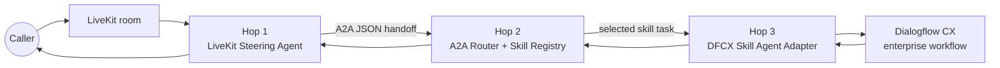

# Master Architecture

The system is split into three independently deployable hops. The A2A contract is the boundary between voice orchestration and enterprise skill execution.

## Hop responsibilities

### Hop 1: LiveKit steering agent

- Connects the caller to a LiveKit voice session.
- Performs identity verification and stores session, ANI, caller name, and authentication state.
- Asks what the caller needs and preserves the utterance in the caller's own words.
- Sends one vendor-neutral handoff to Hop 2.
- Speaks the normalized skill response or a safe service-unavailable message.
- Transfers to the contact-center queue when the skill response requests it.

Hop 1 does not classify Dialogflow intents, call Dialogflow APIs, own the skill registry, or create provider sessions.

### Hop 2: A2A router and skill registry

- Validates the A2A envelope and handoff version.
- Correlates the task with `task_id`, `context_id`, and the LiveKit session ID.
- Discovers the capability and selects the registered skill.
- Applies routing policy, timeout, and failure handling.
- Calls the selected Hop 3 skill adapter and returns a task state plus structured artifact.

The registry is metadata owned by the router; it is not an extra runtime network hop.

### Hop 3: DFCX skill agent adapter

- Implements the A2A skill-agent contract.
- Maps generic caller context and utterance into a Dialogflow CX request.
- Owns Dialogflow CX project, location, agent, environment, and session lifecycle.
- Calls `StreamingDetectIntent` or the configured CX API and normalizes the result.
- Returns response text, match metadata, and the Dialogflow session reference.

The adapter currently uses the DFCX draft environment. A version and published environment are required before production. The adapter also self-primes agents that require a welcome turn by sending plain text; it does not send a `WELCOME` event.

## Cross-hop rules

- Use the LiveKit room name as the correlation/session ID and carry it unchanged.
- Keep provider-specific fields inside Hop 3 responses; Hop 1 consumes generic response text and status.
- Use explicit timeouts and versioned contracts.
- Emit structured logs with `lk_session_id`, `task_id`, and `context_id` so one call can be traced across services.
- Preserve `TASK_STATE_FAILED`, `TASK_STATE_REJECTED`, and `TASK_STATE_CANCELED` as failures even when the gateway HTTP status is 200.