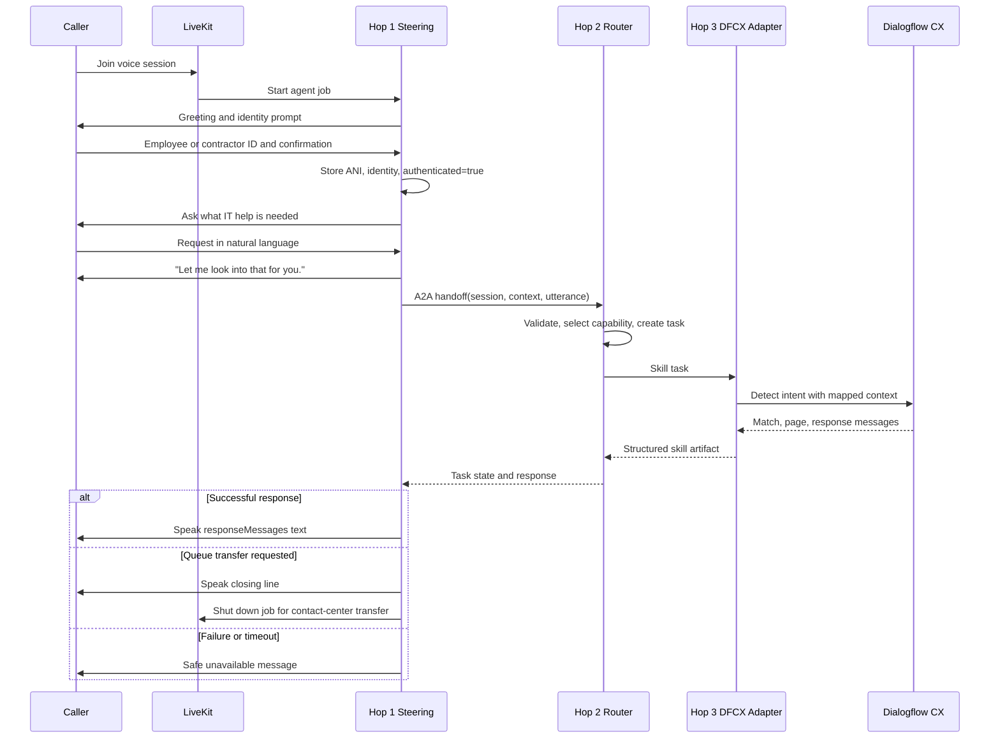

# Call Flow

## Important behavior

1. Hop 1 sends the original request and does not pre-classify or shorten it.
2. The gateway can return HTTP 200 while the task state is failed; Hop 1 checks `status.state` and the structured response.
3. The caller hears a filler line during the multi-second downstream round trip.
4. A successful skill response is spoken exactly as returned.
5. Internal error text is logged and traced but is not read aloud.
6. Queue-transfer responses cause Hop 1 to play the closing line fully before shutting down.