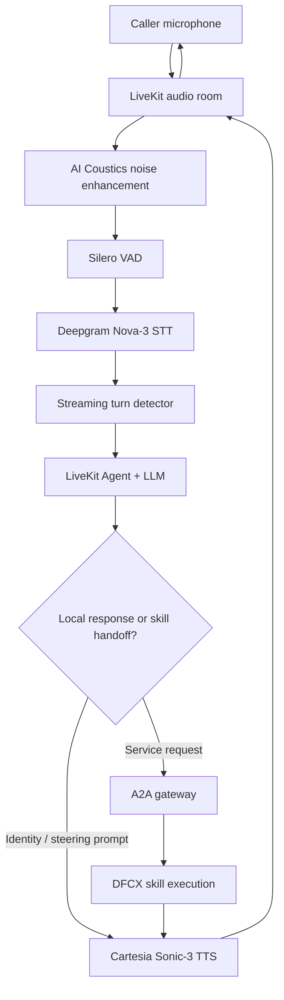

# Voice AI Pipeline

## Processing stages

| Stage | Design |
| --- | --- |
| Audio ingress | LiveKit provides the real-time room and job lifecycle. AI Coustics enhancement reduces noise before recognition. |
| Voice activity | Silero VAD anchors speech timing to wall-clock events. A 250 ms minimum silence avoids delayed commits after an agent handoff. |
| Recognition | Deepgram Nova-3 runs in multilingual mode and produces the caller transcript. |
| Turn completion | The streaming turn detector decides when the caller has finished. Preemptive generation is disabled so tools do not execute speculatively or twice. |
| Reasoning | The initial model is GPT-4o-mini. The AI control plane selects GPT-4o-mini, GPT-4.1-mini, or GPT-4.1 by utterance complexity for later turns. |
| Orchestration | The identity agent collects caller context, then transfers to the steering agent. The steering agent invokes the A2A handoff tool once. |
| Skill execution | Hop 2 routes the request and Hop 3 maps it to Dialogflow CX. Hop 1 remains vendor-neutral. |
| Speech output | Cartesia Sonic-3 renders prompts, filler text, skill responses, and queue-closing text back into the LiveKit room. |

## Latency and reliability

- The expected downstream round trip is about 6.5 seconds, so Hop 1 speaks filler before awaiting the result.
- The A2A timeout defaults to 35 seconds and should exceed the Hop 2 downstream timeout.
- Empty utterances are rejected before a handoff.
- Gateway, task, skill, and DFCX failures become a spoken fallback rather than silence or fabricated content.
- Correlate logs using the LiveKit room name (`lk_session_id`), A2A `task_id`, and `context_id`.
- Keep audio turn timing and tool invocation deterministic; disable preemptive generation and retain explicit VAD configuration.